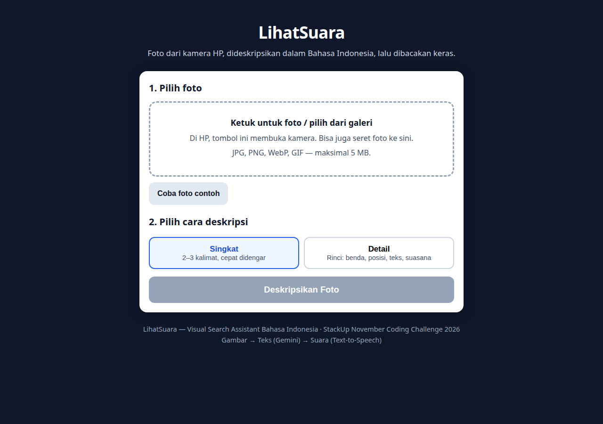
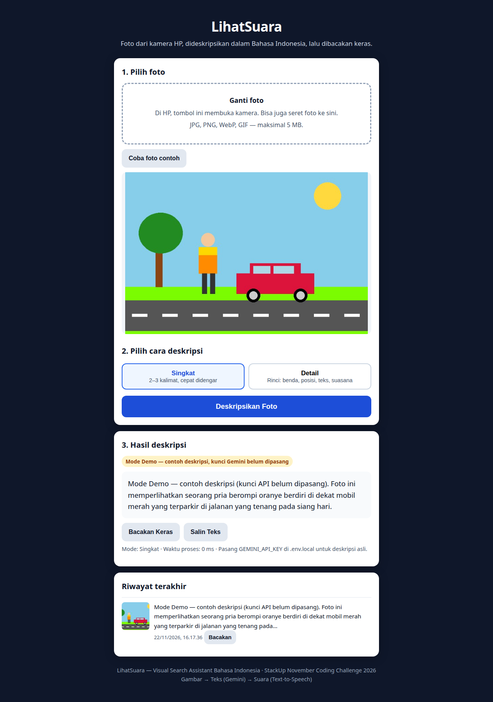
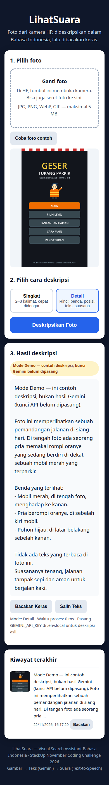

# LihatSuara — Visual Search Assistant Bahasa Indonesia

> Foto dari kamera HP, dideskripsikan Gemini dalam Bahasa Indonesia, lalu dibacakan keras.
> Dibangun untuk **StackUp November Coding Challenge 2026** — tema *"From Words to Worlds –
> Multimodal GenAI"*, challenge statement **#2: Create a Visual Search Assistant**.
>
> **Status:** model **Gemini 3.5 Flash** — terverifikasi live 23 Nov 2026 (deskripsi asli jalan
> di desktop + HP, 0 console error). Kunci Gemini via env var `GEMINI_API_KEY`.



## Masalah yang diselesaikan

Orang dengan penglihatan terbatas (low-vision) tidak bisa "membaca" foto di HP-nya: foto dari
keluarga, papan pengumuman, atau isi kulkas. Aplikasi berbahasa Inggris yang ada tidak
membantu pengguna Indonesia — deskripsinya sulit dipahami, apalagi dibacakan.

**LihatSuara** menutup celah itu: foto apa pun → deskripsi **Bahasa Indonesia yang sederhana**
→ dibacakan keras dengan suara Bahasa Indonesia. Tiga modalitas dalam satu alur:
**Gambar masuk → Teks → Suara keluar.**

## Cara kerja (input → output)

```
[Kamera HP / Galeri / Drag-drop / Foto contoh]
        │  gambar (JPG/PNG/WebP/GIF, maks 5 MB)
        ▼
[POST /api/describe]  ── FormData { image, mode }
        │
        ├── Tanpa GEMINI_API_KEY → Mode Demo (deskripsi contoh, tetap end-to-end)
        └── Dengan kunci → Gemini 3.5 Flash (multimodal, image + prompt Bahasa Indonesia)
        │       Prompt "Singkat": 2–3 kalimat — benda/orang utama, posisi, warna mencolok.
        │       Prompt "Detail": gambaran keseluruhan + daftar benda/posisi/warna
        │       + teks yang terbaca + satu kalimat suasana/kewaspadaan.
        ▼
[Teks deskripsi Bahasa Indonesia]  ── ditampilkan + disimpan di Riwayat (5 terakhir)
        │
        ├── [Bacakan Keras] → Web Speech API (speechSynthesis), suara id-ID bila tersedia
        └── [Salin Teks] → clipboard
```

**Interaksi antar-modalitas:** gambar adalah satu-satunya input; teks adalah jembatan (hasil
Gemini sekaligus naskah TTS); suara adalah output akhir yang dipakai pengguna low-vision.
Mode *Singkat* vs *Detail* mengubah prompt Gemini — bukan sekadar memotong teks — sehingga
kedua mode menghasilkan deskripsi yang memang ditulis untuk durasi dengar yang berbeda.

## Tampilan

Hasil deskripsi (mode Singkat, foto contoh):



Tampilan HP (mode Detail):



## Fitur

- **Kamera HP langsung** (`capture="environment"`) + galeri + drag-and-drop + **tombol "Coba foto contoh"** — juri bisa mencoba alur penuh tanpa menyiapkan foto.
- **Dua mode deskripsi:** Singkat (cepat didengar) dan Detail (benda, posisi, teks, suasana).
- **TTS Bahasa Indonesia** — otomatis memilih suara `id-ID` bila tersedia; tombol Berhenti.
- **Riwayat 5 deskripsi terakhir** (localStorage) lengkap dengan thumbnail dan tombol Bacakan.
- **Aksesibilitas diutamakan:** tombol besar (min. 48–56 px), kontras tinggi, label ARIA,
  mobile-first, seluruh UI berbahasa Indonesia.
- **Penanganan error yang ramah:** format tidak didukung, file > 5 MB, dan kegagalan API
  semuanya menampilkan pesan Bahasa Indonesia yang jelas (bukan stack trace).
- **Mode Demo tanpa kunci:** tanpa `GEMINI_API_KEY` aplikasi tetap jalan end-to-end dengan
  deskripsi contoh yang diberi label jelas — tidak ada layar kosong atau crash.

## Instalasi langkah demi langkah

### Syarat

- Node.js 18.18+ dan npm.
- (Opsional, untuk deskripsi asli) Kunci Gemini gratis dari Google AI Studio.

### 1. Clone dan instal dependensi

```bash
git clone <url-repo-ini>
cd lihatsuara
npm install
```

### 2. Kunci Gemini (opsional — tanpa ini aplikasi jalan dalam Mode Demo)

1. Buka https://aistudio.google.com/app/apikey dan buat kunci API (gratis).
2. Salin `.env.example` menjadi `.env.local`, lalu isi kuncinya:

```bash
cp .env.example .env.local
# edit .env.local:
# GEMINI_API_KEY=isi_kunci_anda_di_sini
```

> **Jangan pernah commit `.env.local`.** File itu sudah ada di `.gitignore`. Tanpa kunci,
> aplikasi memakai deskripsi contoh (Mode Demo) — semua fitur lain tetap berfungsi.
>
> **Kalau dapat error `403 PERMISSION_DENIED` / `ACCESS_DENIED` pada
> `generativelanguage.googleapis.com`:** kunci Anda valid, tapi Generative Language API
> belum diaktifkan di project kunci itu (atau kunci dibatasi ke API lain). Perbaiki di
> Google Cloud Console → APIs & Services → Library → cari "Generative Language API" →
> Enable; atau buat kunci baru tanpa API restrictions.

### 3. Jalankan

```bash
npm run dev     # http://localhost:3000
```

### 4. Build produksi

```bash
npm run build
npm run start   # http://localhost:3000
```

### 5. Deploy live (opsional)

Proyek ini aplikasi Next.js standar — deploy satu klik ke
[Vercel](https://vercel.com/new) (import repo → tambahkan env var `GEMINI_API_KEY` di
pengaturan proyek → Deploy). Alternatif: `npm run build` lalu jalankan `npm run start`
di server mana pun dengan Node.js 18+.

## Pengujian

```bash
python3 test-slice.py   # butuh Playwright + Chrome; menguji alur penuh:
                         # upload -> deskripsi -> hasil tampil, desktop + HP
```

Hasil tes terakhir (22 Nov 2026, mode Mock/Mode Demo): **semua lolos, 0 console error** —
desktop (1280×900) dan HP (390×844, mode Detail).

## Kinerja (diukur, bukan klaim)

| Metrik | Nilai |
|---|---|
| First Load JS halaman utama | 89,9 kB (hasil `next build`) |
| Latensi API mode Mock | ~0 ms (deskripsi contoh, tanpa round-trip LLM) |
| Batas ukuran foto | 5 MB (ditolak ramah di atas itu) |
| Format diterima | JPG, PNG, WebP, GIF |
| TTS | 100% sisi klien (Web Speech API) — tanpa biaya server |

**Optimasi yang dilakukan:** route API hanya menerima `multipart/form-data` dan menolak
format/ukuran tidak valid *sebelum* memanggil Gemini (menghemat kuota LLM); thumbnail
riwayat dibuat di klien via `<canvas>` (maks. 144 px) supaya `localStorage` tidak membengkak;
hasil build Next.js terkompresi (89,9 kB first load).

## Struktur proyek

```
app/
  layout.jsx            # metadata + lang="id"
  page.jsx              # seluruh UI (client component): upload, mode, hasil, TTS, riwayat
  globals.css           # gaya: mobile-first, kontras tinggi, target sentuh besar
  api/describe/route.js # POST /api/describe — validasi + panggil Gemini
lib/
  gemini.js             # client Gemini + prompt Singkat/Detail + fallback Mock
public/
  sample.jpg            # foto contoh (ilustrasi) untuk tombol "Coba foto contoh"
  favicon.svg
shots/                  # screenshot untuk README (diambil dari aplikasi yang sedang jalan)
test-slice.py           # tes Playwright end-to-end (desktop + HP)
```

## Teknologi

- **Next.js 14** (App Router) + React 18 — sesuai stack yang disebut juri.
- **Gemini 3.5 Flash** via `@google/generative-ai` — model multimodal (gambar + teks).
- **Web Speech API** (`speechSynthesis`) — text-to-speech Bahasa Indonesia, tanpa server.
- Tanpa database, tanpa akun, tanpa biaya berjalan selain pemakaian Gemini.

## Lisensi

MIT — lihat `LICENSE`.
